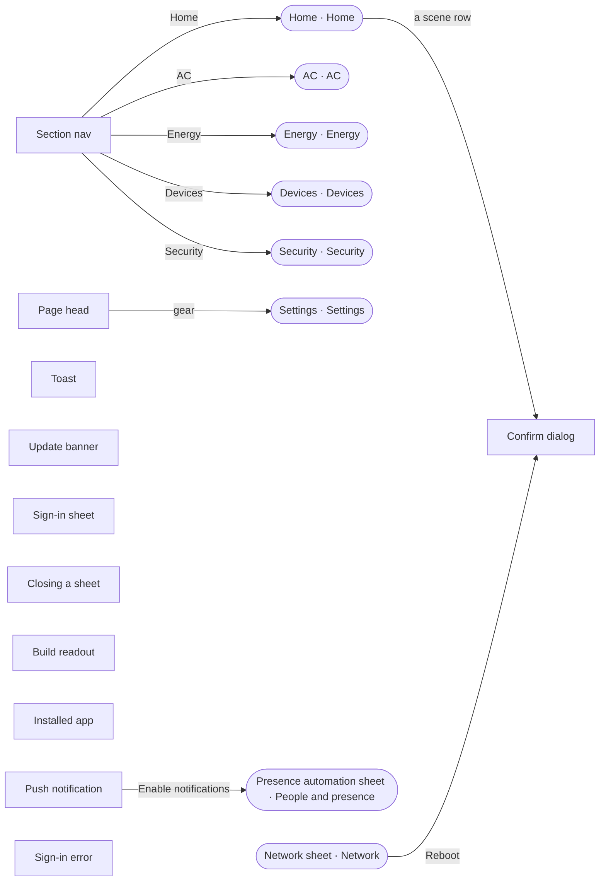
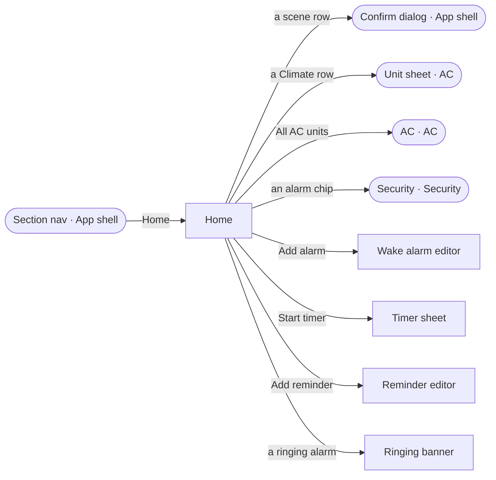
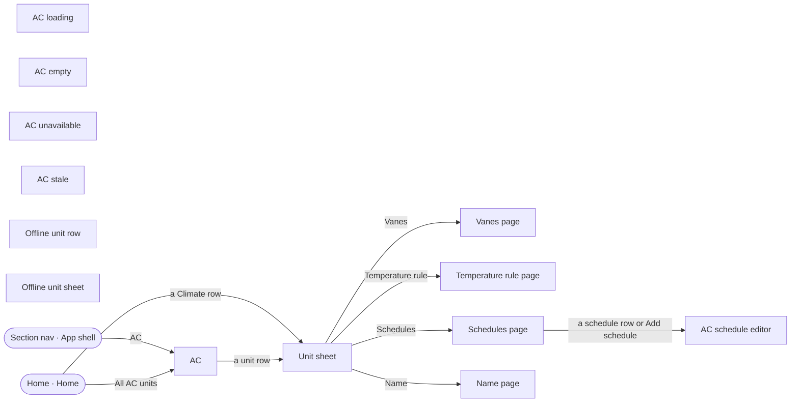
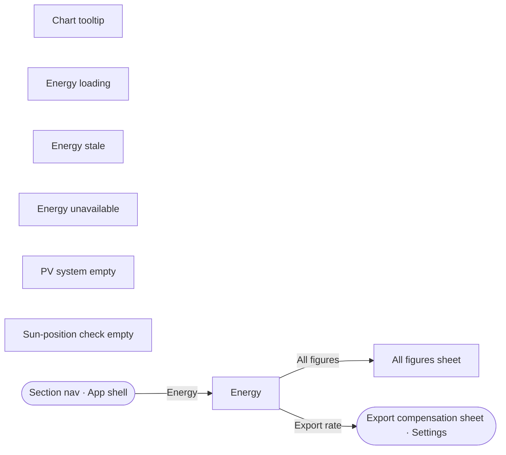
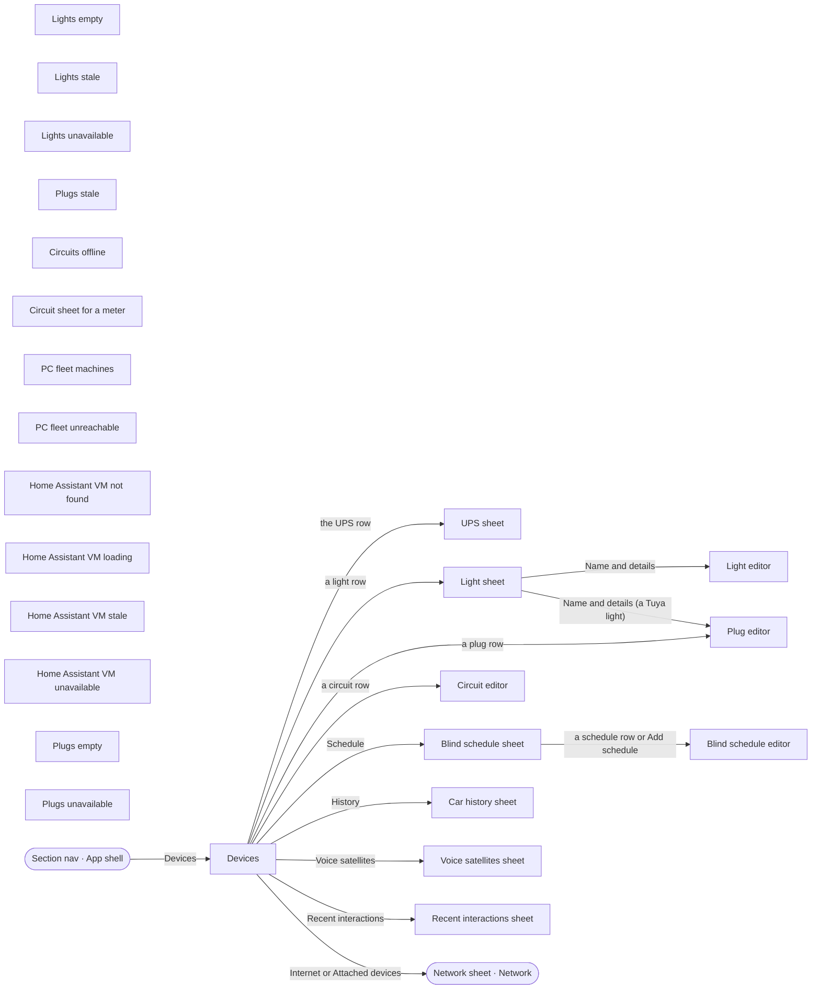
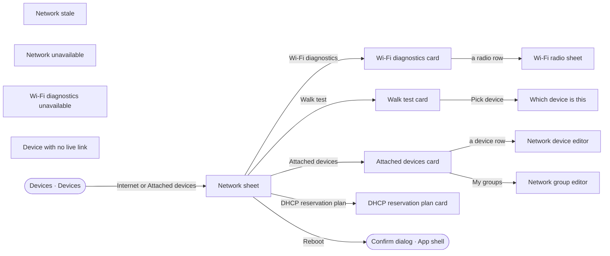
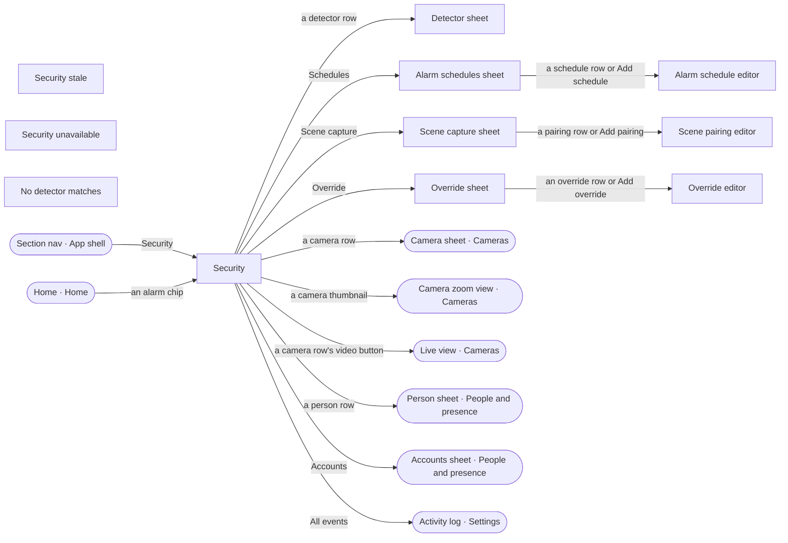
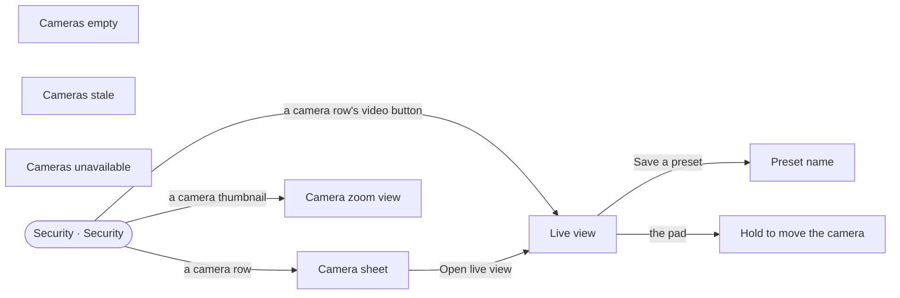
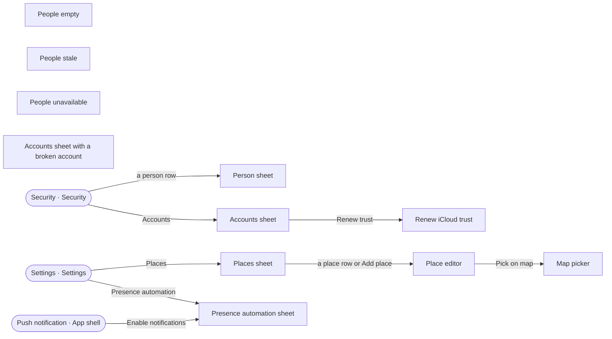
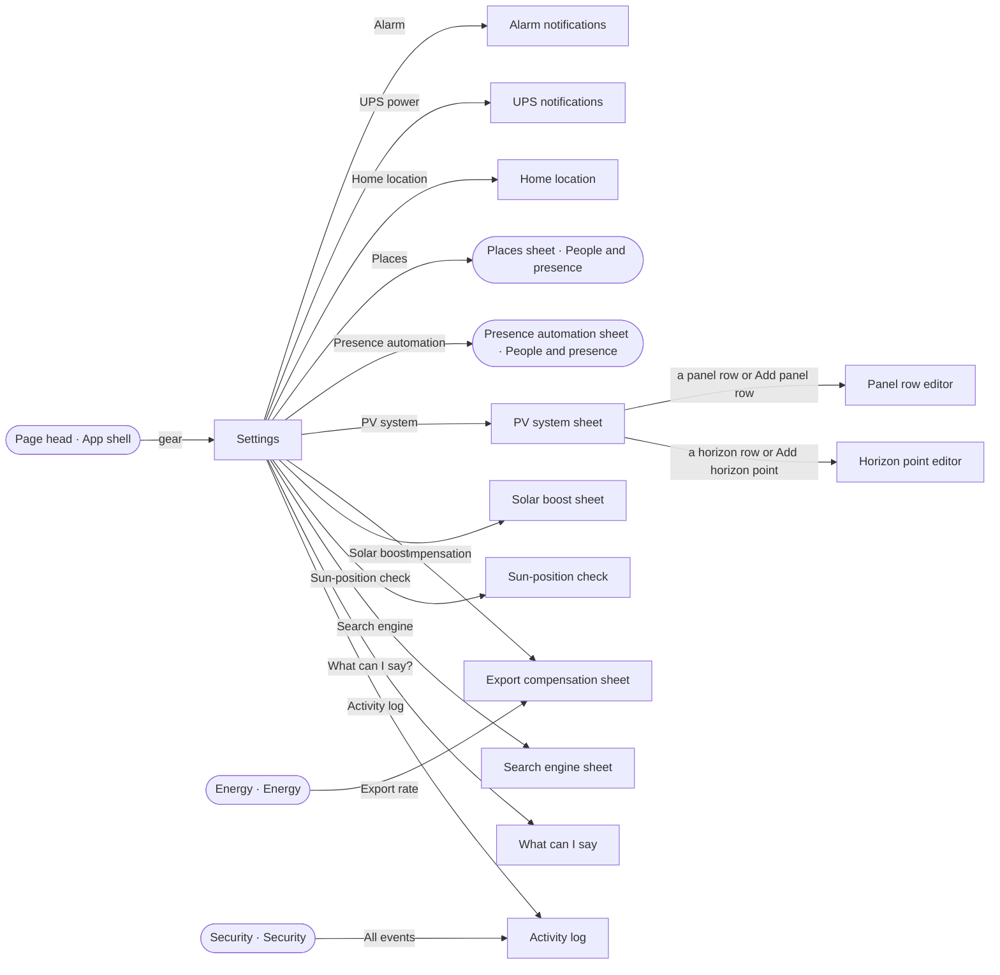

<!-- Generated from docs/ux-surfaces.yaml by scripts/ux_surface_map.py. Do not edit: change the map and re-run. -->

# UX surface map: home-automation

Every surface a person can reach in this app, each under a stable id that its root element carries as `data-surface`. Each area has a diagram of how its surfaces connect; a rounded node is a surface in another area.

The checklist of everything a person can see and do in the Home Automation webapp: every tab, sheet, editor, dialog and Settings row, with how it is reached, what is on it, what each control does and the decision behind it where one exists. It is a single-page app served at `/`: six panes in `main.app` and about fifty `<dialog>` sheets appended to the page. This page is the exhaustive index, so a layout change can check every surface and not only the ones a reviewer happens to open. The behaviour a surface only links to lives in its own doc under `docs/`.

**Keeping it true.** A change that adds, removes, renames or reshapes a user-visible surface updates its entry in `docs/ux-surfaces.yaml` in the same change, with the entry's *why* when the choice was deliberate, and regenerates this page with `python scripts/ux_surface_map.py`; this page is never edited by hand. The rule is in `CLAUDE.md`.

**Ids.** `<area>.<surface>`, lowercase words joined by `.` or `-`, the same form the e2e `surface(page, "<id>")` hook takes. An id never changes when a title is reworded, and one id names one surface. The surface's root element carries the same id as `data-surface`; `scripts/ux_surface_ratchet.py` fails a surface root without an id, an id without an entry, an entry no element carries, an id on two roots, a link to an id with no entry and a page that is not what the map generates. It reads markup and JS, so the entries marked `none` and every state with no root of its own are held by this map and the e2e walk alone.

## Ground rules

**Five tabs, one gear.** The nav is Home · AC · Energy · Devices · Security. Settings is not a tab: the gear in every page head opens its pane, and choosing any tab leaves it. The stored tab is never Settings, so a reload from Settings reopens the last real tab. Older stored tab names (Plugs, Lights, Network) fold into Devices.

**Layout bands.** One markup, two placements. On a phone and in an installed PWA the nav is a floating bottom pill; on a desktop window it is a segmented bar pinned to the top. Every pane opens with the same head (title, one live line, theme toggle, Settings gear) and then a column of cards.

**Two sheet models.** Every sheet is a native `<dialog>`. An *instant* sheet (a device or a settings sheet) applies each change as it is made, with a toast, and its one footer primary is **Done**, which only closes. A *staged* sheet (an editor of one saved item: a schedule, a name, a place) saves only on **Save**; × , Esc and a tap on the backdrop discard it. Closing any sheet returns focus to the control that opened it.

**Row anatomy.** Every device, unit, detector and person is one shared row: a leading avatar, a one-line title, at most one muted meta line, and one trailing item (a switch, a value or a verb group). The row's main area opens the item's sheet; the trailing item acts without opening it.

**Gating.** A group appears only when it has something to show: Blinds, Plugs and the Car card stay hidden until the devices exist (Car: until the vehicle service is configured), Home Assistant's Interactions row hides when nothing was collected, Cameras and People show their own empty line. A group that cannot read shows its last good figures marked stale, or an unreachable line, never a blank card.

**View states.** Every group that reads from a device follows one model, stamped as `data-state` on its pane or list: loading, ready, empty (nothing configured), error (the read failed and nothing earlier exists, shown as a message with a Retry button) and stale (the read failed but a saved copy exists, shown with a *Last updated … · live data unavailable* note and its writes disabled). Those renderings are the `… loading`, `… empty`, `… unavailable` and `… stale` entries below.

**Where state lives.** Per-device choices live in `localStorage`: theme, text size, the last tab, the show-hidden switches. Everything else is read from `/api/*`. The token for a remote device lives in the browser after sign-in.

**Reading the diagrams.** Every row-level surface is reached from a tab; a sheet reached from a Settings row can also be reached from the tab it concerns (the Energy tab's Export rate row opens Settings and then that row's sheet).

## Keyboard

| Key | Does |
| --- | --- |
| Esc | closes the open sheet; a staged sheet discards |
| Enter | in a name field, saves the staged sheet |
| Tab / Shift+Tab | moves between controls; the nav tabs use the arrow keys |

## Empty, error and loading states

| Where | State | What shows |
| --- | --- | --- |
| Any tab | server unreachable or a read failing | the page head's live line and the group's own note say so; last good figures stay, marked stale |
| Any tab | not signed in (remote device) | the sign-in sheet over the page |
| AC, Devices | no devices | the group states it has none |
| Energy | no history yet | *No history yet — samples accrue while the app runs.* |
| Energy | no PV panel rows | the forecast is empty with a line pointing to Settings › PV system |
| Security | panel unreachable | a *Panel unreachable* chip on Home and the state line on Security |

## Where this map was checked

Walked on a disposable instance started by the repo's own synthetic boot (`scripts/design_review_synthetic.py`: every automation engine off, every runtime database in a temp directory, every credential blank, a sample-config-only copy of the checkout) in one paced browser at 390 by 844 in light and dark: all five tabs, Settings and twelve sheets were opened, and the running page carried every stamped id but the update banner, which only a newer build raises. That instance reaches no device, so it shows the error states; the populated views were checked against the e2e suite's stubbed fixture shots (`tests/e2e/shots`) and the entries' `states` against `tests/e2e` names, so nothing here comes from the household's real devices. Not driven live, only read from the code: a real camera pan, the iCloud trust code round trip, a real router reboot and the push-notification permission prompt (each needs a device or an account this instance never reaches).

Walked 2026-11-17 against build `0635828`, at widths 390, 1280, themes light, dark.

## Areas

| Area | Surfaces |
|---|---|
| [App shell](#app-shell) | 11 |
| [Home](#home) | 5 |
| [AC](#ac) | 13 |
| [Energy](#energy) | 8 |
| [Devices](#devices) | 25 |
| [Network](#network) | 13 |
| [Security](#security) | 11 |
| [Cameras](#cameras) | 8 |
| [People and presence](#people-and-presence) | 11 |
| [Settings](#settings) | 13 |

## App shell

What every tab shares: the nav, the page head, the toast, the confirm dialog, the update banner and the sign-in sheet.

### `app.nav` Section nav

- **Root:** `data-surface`
- **Reach:** always on screen except under an open sheet
- **Holds:**
  - five tabs in order, Home, AC, Energy, Devices, Security, each with an icon and a label
  - a count badge on a tab that needs attention (a tab with a danger count paints it in the danger fill)
- **Does:**
  - a tap switches tab and remembers it for the next visit
  - the arrow keys move between tabs
- **Phone:** a floating bottom pill with a sliding active capsule
- **Desktop:** a segmented bar pinned to the top of the page
- **Why:** six destinations would not fit a bottom bar, so Settings is the gear in every head instead of a sixth tab
- **Leads to:**
  - [Home](#homecards-home) (Home)
  - [AC](#acunits-ac) (AC)
  - [Energy](#energyoverview-energy) (Energy)
  - [Devices](#iotdevices-devices) (Devices)
  - [Security](#securitypane-security) (Security)

### `app.page-head` Page head

- **Root:** none — drawn inside each tab's pane, not an element of its own
- **Reach:** the top card of every pane
- **Holds:**
  - the tab's title
  - one live line (Home shows the weather; the others show their own status)
  - the theme toggle
  - the Settings gear (not on Settings itself)
- **Does:**
  - the theme toggle flips light and dark and remembers it for this device
  - the gear opens Settings over the current tab
- **Leads to:** [Settings](#settingsroot-settings) (gear)

### `app.toast` Toast

- **Root:** `data-surface`
- **Reach:** appears after an action: saved, failed, enabled, copied
- **Holds:** one line of feedback, in the success or error tone
- **Does:** clears itself
- **States:** an error toast names what failed

### `shared.confirm-dialog` Confirm dialog

- **Root:** `data-surface`
- **Reach:** a deliberate action asks once: running a scene, deleting an item from its editor or a camera preset, a router or access point reboot, applying the DHCP plan, shutting the Home Assistant VM down, pairing Tuya devices, removing an export rate or a network group
- **Holds:**
  - a title and one line saying what will happen
  - Cancel and Confirm
- **Does:** Confirm runs the action; Cancel, Esc and the backdrop abandon it
- **Why:** one reusable styled dialog replaces the browser's confirm box, which an installed PWA renders badly

### `app.update-banner` Update banner

- **Root:** `data-surface`
- **Reach:** appears when the served build differs from the running one
- **Holds:** a "New version available" line with a Reload button
- **Does:** Reload fetches the new build
- **Why:** a long-lived PWA otherwise keeps running a stale build indefinitely

### `shared.login` Sign-in sheet

- **Root:** none — built inside the vendored sign-in component, which stamps no id
- **Reach:** any request that answers 401 on a remote device
- **Holds:** a password field and a Sign in button
- **Does:** signing in stores the token and reloads the page
- **States:** a wrong password shows its message in the sheet and keeps it open
- **Why:** the app cannot be used signed out, so the sheet has no close button and Esc does nothing

### `app.sheet-dismiss` Closing a sheet

- **Root:** none — a behaviour of every sheet, not an element
- **Reach:** the × in a sheet's head, Esc, a tap on the backdrop
- **Does:**
  - an instant sheet closes with its changes already applied
  - a staged sheet discards its draft
  - focus returns to the control that opened it
- **Why:** one shell owns the close paths so no sheet closes differently or reopens on a stale focus target

### `app.build-readout` Build readout

- **Root:** `data-surface`
- **Reach:** the foot of every pane
- **Holds:** the running build, as the short commit id and its build time
- **Why:** a long-lived PWA can run a stale build, so the readout is how a person (or a restart check) confirms which one is live

### `app.install-shell` Installed app

- **Root:** none — the manifest, icons and standalone display, with no element of their own
- **Reach:**
  - Add to Home Screen on a phone
  - a token in the address (`?token=`) signs a remote browser in once, then is removed from the address
- **Holds:** the app name, the icons and a standalone window
- **Why:** the app is a PWA reached over the tailnet, so it installs like an app and opens without browser chrome

### `app.push-notification` Push notification

- **Root:** none — an operating-system notification shown by the service worker, not an element
- **Reach:** Enable notifications in Presence automation, then a presence event
- **Holds:** a title and a line of text
- **Does:** tapping it opens the app at the address it carries
- **Leads to:** [Presence automation sheet](#settingspresence-automation-sheet-presence-automation-sheet) (Enable notifications)

### `shared.login-error` Sign-in error

- **Root:** none — a state drawn inside the sign-in sheet, with no root of its own
- **Reach:** a wrong password in the sign-in sheet
- **Holds:**
  - the message Wrong password
  - the sheet stays open and the field stays editable

## Home

The default tab. A glance at whether the house is fine, the three scenes, the climate rows and the time-led list of alarms, timers and reminders.

### `home.cards` Home

- **Root:** `data-surface`
- **Reach:**
  - the Home tab
  - the first visit
- **Holds:**
  - the head with the weather as its live line
  - House, the glance card with alarm mode, the energy flow and who is home
  - Scenes, three one-tap rows
  - Climate, the AC unit rows
  - Next up, the wake alarms, timers and reminders in time order
- **Does:**
  - an exception chip in the House head opens the tab that owns it (Security for the alarm)
  - the alarm segmented control sets Off, Partial, Perimeter or Full
  - a scene row asks once, then runs the scene across the blinds, the AC and the alarm together
  - a Climate row's switch powers a unit; the row opens the unit sheet
  - All AC units opens the AC tab
  - Add alarm, Start timer and Add reminder open their sheets
- **States:**
  - a normal house shows no chips
  - panel unreachable shows a chip and disables the alarm control
  - with units pinned, Climate lists only those, each with a setpoint stepper
- **Why:** the first screen answers whether the house is fine, so exceptions surface as chips and nothing else competes for attention
- **Leads to:**
  - [Confirm dialog](#sharedconfirm-dialog-confirm-dialog) (a scene row)
  - [Unit sheet](#acunit-sheet-unit-sheet) (a Climate row)
  - [AC](#acunits-ac) (All AC units)
  - [Security](#securitypane-security) (an alarm chip)
  - [Wake alarm editor](#homewake-alarm-dialog-wake-alarm-editor) (Add alarm)
  - [Timer sheet](#homewake-timer-sheet-timer-sheet) (Start timer)
  - [Reminder editor](#homereminder-dialog-reminder-editor) (Add reminder)
  - [Ringing banner](#homewake-ringing-ringing-banner) (a ringing alarm)

### `home.wake-ringing` Ringing banner

- **Root:** `data-surface`
- **Reach:** a wake alarm is ringing or a timer finished
- **Holds:** the alarm or timer that needs attention, first in Next up
- **Does:** dismisses the alarm or timer
- **Why:** an alarm that rings must be the first thing in the list, ahead of the ones that are merely scheduled

### `home.wake-alarm-dialog` Wake alarm editor

- **Root:** `data-surface`
- **Reach:**
  - Add alarm
  - a wake alarm row
- **Holds:**
  - Enabled, Time, Label, Just once with a Date, the weekday chips
  - a hint on how to set the same alarm by voice
- **Does:** Save stores it; Delete wake alarm removes it
- **States:** a new alarm has no Delete
- **Why:** a wake alarm only rings at a time; it never arms or disarms the alarm system

### `home.wake-timer-sheet` Timer sheet

- **Root:** `data-surface`
- **Reach:** Start timer
- **Holds:**
  - quick starts of 5, 10, 15 and 30 minutes
  - a Minutes field with Start timer
  - a hint on how to start one by voice
- **Does:**
  - a quick start or Start timer begins a countdown that shows in Next up
  - a running timer is cancelled with its × in Next up

### `home.reminder-dialog` Reminder editor

- **Root:** `data-surface`
- **Reach:**
  - Add reminder
  - a reminder row
- **Holds:**
  - Text, a Due date switch with Date and Time
  - a hint on how to add one by voice
- **Does:** Save stores it; Delete reminder removes it
- **States:** a new reminder has no Delete

## AC

### `ac.units` AC

- **Root:** `data-surface`
- **Reach:**
  - the AC tab
  - All AC units on Home
- **Holds:**
  - the head with the AC status as its live line
  - one row per air conditioner with its power switch
  - a feedback line for a failed write
- **Does:**
  - a row's switch powers the unit
  - a row opens the unit sheet
- **States:** an offline unit's row says so and its changes cannot be sent
- **Why:** power is on the row and everything else is one tap away, so the common action never needs the sheet
- **Leads to:** [Unit sheet](#acunit-sheet-unit-sheet) (a unit row)

### `ac.unit-sheet` Unit sheet

- **Root:** `data-surface`
- **Reach:** a unit row on AC or Home
- **Holds:**
  - the setpoint with minus and plus steppers
  - Power, Pin to Home
  - Mode and Fan
  - four settings rows: Vanes, Temperature rule, Schedules, Name
  - Done
- **Does:**
  - each change is sent as it is made; Done only closes
  - a settings row opens its page of the same sheet
- **States:**
  - an offline unit shows a line saying changes cannot be sent until it reconnects
  - Fan and Vanes appear only for a unit whose capabilities have them
- **Why:** the main page holds the daily controls and the rarer settings sit one row deeper, so the sheet stays short on a phone
- **Leads to:**
  - [Vanes page](#acunit-sheet-vanes-vanes-page) (Vanes)
  - [Temperature rule page](#acunit-sheet-rule-temperature-rule-page) (Temperature rule)
  - [Schedules page](#acunit-sheet-schedules-schedules-page) (Schedules)
  - [Name page](#acunit-sheet-name-name-page) (Name)

### `ac.unit-sheet-vanes` Vanes page

- **Root:** `data-surface`
- **Reach:** Vanes in the unit sheet
- **Holds:** a Vertical and a Horizontal selector, each shown only when the unit has that vane
- **Does:**
  - a choice is sent as it is made
  - Back returns to the main page

### `ac.unit-sheet-rule` Temperature rule page

- **Root:** `data-surface`
- **Reach:** Temperature rule in the unit sheet
- **Holds:**
  - Enabled, a Cool target and a Heat target for the room
  - Solar boost with a Boost offset
  - a line saying the rule steers the setpoint until the room reaches the target, and boost goes further while there is surplus
- **Does:** each field is applied as it is made
- **Why:** the rule keeps the unit's setpoint working toward a room temperature instead of the unit's own sensor

### `ac.unit-sheet-schedules` Schedules page

- **Root:** `data-surface`
- **Reach:** Schedules in the unit sheet
- **Holds:**
  - one row per schedule
  - Add schedule
  - a line saying each runs once a day and an Off entry only turns the unit off
- **Does:** a row and Add schedule open the schedule editor
- **States:** no schedules shows *No schedules yet.*
- **Leads to:** [AC schedule editor](#acac-schedule-dialog-ac-schedule-editor) (a schedule row or Add schedule)

### `ac.unit-sheet-name` Name page

- **Root:** `data-surface`
- **Reach:** Name in the unit sheet
- **Holds:** a Display name field
- **Does:** Enter or leaving the field saves the name

### `ac.ac-schedule-dialog` AC schedule editor

- **Root:** `data-surface`
- **Reach:**
  - Add schedule
  - a schedule row
- **Holds:**
  - Enabled, Time, Power On or Off
  - Mode, Set temp now, Target temp, Fan, Vane vertical, Vane horizontal
- **Does:** Save stores it; Delete schedule removes it
- **States:**
  - an Off entry only turns the unit off, as the Schedules page says
  - the two vane fields appear only for a unit that has that vane

### `ac.loading` AC loading

- **Root:** none — a state drawn inside the AC pane, with no root of its own
- **Reach:** the AC tab before its first read lands
- **Holds:** a spinner with the unit rows not yet drawn

### `ac.empty` AC empty

- **Root:** none — a state drawn inside the AC pane, with no root of its own
- **Reach:** the account has no air conditioners
- **Holds:** an empty-state message instead of rows

### `ac.unavailable` AC unavailable

- **Root:** none — a state drawn inside the AC pane, with no root of its own
- **Reach:** the read failed and no earlier figures exist
- **Holds:**
  - an empty-state message reading AC units unavailable
  - the cloud error is shown without its host name

### `ac.stale` AC stale

- **Root:** none — a state drawn inside the AC pane, with no root of its own
- **Reach:** the read failed but a saved copy exists
- **Holds:**
  - the saved unit rows with their switches disabled
  - a line reading Last updated and live data unavailable

### `ac.offline` Offline unit row

- **Root:** none — a state drawn inside a unit row, with no root of its own
- **Reach:** a unit the cloud reports as not connected
- **Holds:**
  - the row meta reading Last read instead of live figures
  - a disabled power switch

### `ac.unit-sheet-offline` Offline unit sheet

- **Root:** none — a state drawn inside the unit sheet, with no root of its own
- **Reach:** the sheet opened on an offline unit
- **Holds:**
  - the offline line at the top
  - the last read room temperature
  - the power switch, setpoint steppers, Mode and Fan all disabled

## Energy

### `energy.overview` Energy

- **Root:** `data-surface`
- **Reach:** the Energy tab
- **Holds:**
  - the head with the energy status as its live line
  - an Energy now card, Solar to Home to Grid in one row, then self-sufficiency and self-consumption
  - Today, two meters for what the array made and what the house used, then Saved, CO2 avoided and Export
  - History, a period select (Live, Day, Week, Month, Year, All) and an Energy or Money switch over one chart
  - Solar forecast, with a Yesterday, Today or Tomorrow switch over a curve and the measured generation
- **Does:**
  - Money shows the tariff periods, the All figures row and the Export rate row
  - All figures opens the figures sheet
  - Export rate opens Settings and then the export compensation sheet
- **States:**
  - an asleep inverter dims the Solar node
  - a gap in today's feed adds a note saying the totals read low for that reason
  - no history shows an empty line; no PV panel rows shows a line pointing to Settings
- **Why:** the glance answers whether the house runs on the sun, and the detail sits under it in the order a person asks the questions
- **Leads to:**
  - [All figures sheet](#energyenergy-figures-sheet-all-figures-sheet) (All figures)
  - [Export compensation sheet](#energyexport-rate-sheet-export-compensation-sheet) (Export rate)

### `energy.chart-tooltip` Chart tooltip

- **Root:** none — drawn by the charting library on its canvas, not an element
- **Reach:** hovering or tapping a point on the Live, History, forecast or sun-position chart
- **Holds:** the value at that point, with its time
- **Does:** follows the pointer and disappears when it leaves

### `energy.energy-figures-sheet` All figures sheet

- **Root:** `data-surface`
- **Reach:** All figures in Energy › History › Money
- **Holds:**
  - the bill, the savings and each tariff period as figures
  - Done
- **Does:** only reads; Done closes

### `energy.loading` Energy loading

- **Root:** none — a state drawn inside the Energy pane, with no root of its own
- **Reach:** the Energy tab before its first read lands
- **Holds:** placeholders in the flow row and the meters

### `energy.stale` Energy stale

- **Root:** none — a state drawn inside the Energy pane, with no root of its own
- **Reach:** the live read failed but a saved copy exists
- **Holds:** the saved figures with a live data unavailable note on the Live chart

### `energy.unavailable` Energy unavailable

- **Root:** none — a state drawn inside the Energy pane, with no root of its own
- **Reach:** the live read failed and no earlier figures exist
- **Holds:**
  - a Live unavailable chip in the head
  - the flow row without values

### `energy.pv-system-empty` PV system empty

- **Root:** none — a state drawn inside the PV system sheet, with no root of its own
- **Reach:** the PV system sheet before any panel row exists
- **Holds:**
  - no panel rows
  - the performance ratio and coordinates fields
  - Add panel row

### `energy.sun-overlay-empty` Sun-position check empty

- **Root:** none — a state drawn inside the sun-position sheet, with no root of its own
- **Reach:** a day with no measured hours
- **Holds:** a line saying there are no measured hours for this day instead of the chart

## Devices

Every local device on one tab: Power, Lights, Blinds, Plugs, Circuits, the Car, Home Assistant and Network.

### `iot.devices` Devices

- **Root:** `data-surface`
- **Reach:**
  - the Devices tab
  - an exception chip on Home
- **Holds:**
  - the head with the devices status as its live line
  - Power, the live plug total, the biggest draws and the UPS row
  - Lights, one row each, with All on, All off and Refresh
  - Blinds, an All blinds row, one row per cover with Up, Stop and Down, and a Schedule row
  - Plugs, with Show hidden and Pair
  - Circuits, a row per CT clamp channel, with Show hidden
  - Car, battery and last seen, with a History row
  - Home Assistant, the virtual machine row, Voice satellites and Recent interactions
  - Network, an Internet row and an Attached devices row
- **Does:**
  - a light, plug or circuit row opens its sheet; a row's switch or verbs act without opening it
  - the group rows open their own sheets
- **States:**
  - Blinds, Plugs and Car stay hidden until they have devices
  - the Car card shows no reading, collection off or stale figures as their own lines
  - Recent interactions hides when nothing was collected
- **Why:** every local device is on one tab so a person looks in one place, cloud-free
- **Leads to:**
  - [UPS sheet](#iotups-sheet-ups-sheet) (the UPS row)
  - [Light sheet](#iotlight-sheet-light-sheet) (a light row)
  - [Plug editor](#iotplug-dialog-plug-editor) (a plug row)
  - [Circuit editor](#iotcircuit-dialog-circuit-editor) (a circuit row)
  - [Blind schedule sheet](#iotblind-schedules-sheet-blind-schedule-sheet) (Schedule)
  - [Car history sheet](#iottesla-history-sheet-car-history-sheet) (History)
  - [Voice satellites sheet](#iotha-satellites-sheet-voice-satellites-sheet) (Voice satellites)
  - [Recent interactions sheet](#iotha-interactions-sheet-recent-interactions-sheet) (Recent interactions)
  - [Network sheet](#iotnetwork-sheet-network-sheet) (Internet or Attached devices)

### `iot.ups-sheet` UPS sheet

- **Root:** `data-surface`
- **Reach:** the UPS row in Devices › Power
- **Holds:**
  - Shut down PCs on low runtime, with a Threshold in minutes
  - This PC, last, as Shut down or Hibernate
  - a note that hibernate keeps open work and that the hub host shuts down last
- **Does:** each change applies as it is made; Done closes

### `iot.light-sheet` Light sheet

- **Root:** `data-surface`
- **Reach:** a light row
- **Holds:**
  - Power, brightness and warmth where the light has them
  - Name and details
  - Done
- **Does:**
  - each change is sent as it is made
  - Name and details opens the editor
- **States:** a light that cannot be reached says so at the top
- **Leads to:**
  - [Light editor](#iotlight-dialog-light-editor) (Name and details)
  - [Plug editor](#iotplug-dialog-plug-editor) (Name and details (a Tuya light))

### `iot.light-dialog` Light editor

- **Root:** `data-surface`
- **Reach:** Name and details in the light sheet
- **Holds:**
  - Display name
  - read-only: original name, product, network address, port, hardware address, firmware, colour temperature
- **Does:** Save stores the name

### `iot.plug-dialog` Plug editor

- **Root:** `data-surface`
- **Reach:**
  - a plug row
  - Name and details for a Tuya light
- **Holds:**
  - Display name
  - Hidden
- **Does:** Save stores the name and whether the device is hidden
- **States:** a hidden device leaves the list until Show hidden is on

### `iot.circuit-dialog` Circuit editor

- **Root:** `data-surface`
- **Reach:** a circuit row
- **Holds:**
  - read-only: power, current, energy, voltage, total power, Wi-Fi signal, hardware address
  - Display name
  - Clamp fitted backwards
  - Hidden
- **Does:** Save stores the name, the sign flip and the hidden flag
- **Why:** the figures a person looks up on purpose live here, so each row carries exactly one number

### `iot.blind-schedules-sheet` Blind schedule sheet

- **Root:** `data-surface`
- **Reach:** Schedule in Devices › Blinds
- **Holds:**
  - one row per schedule, Add schedule
  - Follow the automatic alarm, with a line on when all blinds go down and up
- **Does:**
  - a row and Add schedule open the schedule editor
  - Follow the automatic alarm applies as it is toggled
- **Leads to:** [Blind schedule editor](#iotblind-schedule-dialog-blind-schedule-editor) (a schedule row or Add schedule)

### `iot.blind-schedule-dialog` Blind schedule editor

- **Root:** `data-surface`
- **Reach:**
  - Add schedule
  - a schedule row
- **Holds:**
  - Enabled, Time, Action Up or Down
  - Only when Always, Someone is home or Nobody is home
  - Days and Blinds
- **Does:** Save stores it; Delete schedule removes it

### `iot.tesla-history-sheet` Car history sheet

- **Root:** `data-surface`
- **Reach:** History in Devices › Car
- **Holds:**
  - a Week or Month switch
  - Distance, Charged and Efficiency
  - Distance and Charged energy charts, Recent charging, Recent drives
  - a note that home-charging energy is the car's own figure and drive energy is estimated from the battery drop
- **Does:** the switch changes the period

### `iot.ha-satellites-sheet` Voice satellites sheet

- **Root:** `data-surface`
- **Reach:** Voice satellites in Devices › Home Assistant
- **Holds:**
  - one row per Home Assistant room with whether its satellite is online, its state and its speaker volume
  - a Talk microphone per room
- **Does:**
  - Talk records, Stop sends the transcript to be announced in that room
  - one microphone records at a time
- **States:** reading shows *Reading Home Assistant rooms…*

### `iot.ha-interactions-sheet` Recent interactions sheet

- **Root:** `data-surface`
- **Reach:** Recent interactions in Devices › Home Assistant
- **Holds:**
  - what Home Assistant heard, the intent that handled it, the action that ran and the spoken response
  - a note that they are collected only while this app runs
- **Does:** only reads

### `iot.lights-empty` Lights empty

- **Root:** none — a state drawn inside the Lights group, with no root of its own
- **Reach:** no light is configured
- **Holds:** the group note saying there are none

### `iot.lights-stale` Lights stale

- **Root:** none — a state drawn inside the Lights group, with no root of its own
- **Reach:** the light read failed but a saved copy exists
- **Holds:** the saved rows with a last-updated note reading live data unavailable

### `iot.lights-unavailable` Lights unavailable

- **Root:** none — a state drawn inside the Lights group, with no root of its own
- **Reach:** the light read failed and no earlier figures exist
- **Holds:** Lights unavailable with a line to check the light connection and retry

### `iot.plugs-stale` Plugs stale

- **Root:** none — a state drawn inside the Plugs group, with no root of its own
- **Reach:** the Tuya read failed but a saved copy exists
- **Holds:** the saved rows with their switches marked unavailable

### `iot.circuits-offline` Circuits offline

- **Root:** none — a state drawn inside the Circuits group, with no root of its own
- **Reach:** the circuits read failed
- **Holds:** a line reading Circuits unavailable with the cause

### `iot.circuit-meter-dialog` Circuit sheet for a meter

- **Root:** none — a state drawn inside the circuit sheet, with no root of its own
- **Reach:** a meter row in Devices › Circuits
- **Holds:**
  - the meter figures: voltage, total power, Wi-Fi signal and hardware address
  - Display name

### `iot.pc-fleet-machines` PC fleet machines

- **Root:** none — a state drawn inside the UPS sheet, with no root of its own
- **Reach:** the fleet hub answers
- **Holds:** one row per machine in the shutdown list

### `iot.pc-fleet-unreachable` PC fleet unreachable

- **Root:** none — a state drawn inside the UPS sheet, with no root of its own
- **Reach:** the fleet hub does not answer
- **Holds:**
  - a line reading Machine list unavailable because the fleet hub is not reachable
  - the shutdown settings, which stay editable

### `iot.vm-empty` Home Assistant VM not found

- **Root:** none — a state drawn inside the Home Assistant group, with no root of its own
- **Reach:** the virtual machine is not found
- **Holds:** a VM not found state on the row

### `iot.vm-loading` Home Assistant VM loading

- **Root:** none — a state drawn inside the Home Assistant group, with no root of its own
- **Reach:** before the first VM status lands
- **Holds:** a placeholder on the VM row

### `iot.vm-stale` Home Assistant VM stale

- **Root:** none — a state drawn inside the Home Assistant group, with no root of its own
- **Reach:** the VM read failed but a saved copy exists
- **Holds:** the saved state with a live data unavailable note

### `iot.vm-unavailable` Home Assistant VM unavailable

- **Root:** none — a state drawn inside the Home Assistant group, with no root of its own
- **Reach:** the VM read failed and no earlier state exists
- **Holds:** a status unavailable state on the row

### `iot.plugs-empty` Plugs empty

- **Root:** none — a state drawn inside the Plugs group, with no root of its own
- **Reach:** no Smart Life device is configured
- **Holds:** the group's empty line reading No Smart Life devices configured

### `iot.plugs-unavailable` Plugs unavailable

- **Root:** none — a state drawn inside the Plugs group, with no root of its own
- **Reach:** the Tuya read failed and no earlier figures exist
- **Holds:** Plugs and blinds unavailable in place of the rows

## Network

One sheet holds the router and access point health, the Wi-Fi diagnostics, the walk test, the attached devices and the DHCP plan; each is a collapsible card, and the editors open over it.

### `iot.network-sheet` Network sheet

- **Root:** `data-surface`
- **Reach:**
  - Internet in Devices › Network
  - Attached devices in Devices › Network, opened at that card
- **Holds:**
  - the Internet block, a speed test result, Run speed test, a nightly speed test switch and trend sparklines
  - an Access point card and a Router card, each with a reboot button
  - the Wi-Fi diagnostics, Walk test, Attached devices and DHCP reservation plan cards
  - Done
- **Does:**
  - Run speed test measures; the nightly switch runs it once around 03:00
  - Reboot AP and Reboot ask for confirmation
- **States:** a card whose read fails says no data
- **Why:** the nightly speed test is opt-in because it spends real bandwidth
- **Leads to:**
  - [Wi-Fi diagnostics card](#iotnetwork-wifi-diagnostics-wi-fi-diagnostics-card) (Wi-Fi diagnostics)
  - [Walk test card](#iotnetwork-walk-test-walk-test-card) (Walk test)
  - [Attached devices card](#iotnetwork-attached-devices-attached-devices-card) (Attached devices)
  - [DHCP reservation plan card](#iotnetwork-dhcp-plan-dhcp-reservation-plan-card) (DHCP reservation plan)
  - [Confirm dialog](#sharedconfirm-dialog-confirm-dialog) (Reboot)

### `iot.network-wifi-diagnostics` Wi-Fi diagnostics card

- **Root:** `data-surface`
- **Reach:** the Wi-Fi diagnostics card in the network sheet
- **Holds:**
  - the radios on 2.4 GHz and 5 GHz, with recommendations
  - Show hidden, with a count of the hidden radios
- **Does:** a radio opens its editor
- **Leads to:** [Wi-Fi radio sheet](#iotnet-wifi-dialog-wi-fi-radio-sheet) (a radio row)

### `iot.network-walk-test` Walk test card

- **Root:** `data-surface`
- **Reach:** the Walk test card in the network sheet
- **Holds:**
  - an explanation that the phone is the probe and the access point is the meter
  - Pick device, Record here, a room field and the samples so far
- **Does:** Pick device chooses which device this is; Record here stores a sample for the room
- **States:** no device picked says so and disables recording
- **Why:** no browser exposes Wi-Fi scanning, so the access point measures a phone that walks the house
- **Leads to:** [Which device is this](#iotnet-survey-dialog-which-device-is-this) (Pick device)

### `iot.network-attached-devices` Attached devices card

- **Root:** `data-surface`
- **Reach:**
  - the Attached devices card in the network sheet
  - Attached devices in Devices › Network
- **Holds:**
  - device counts, an order switch (A-Z, Signal), Offline hidden, Show hidden, a group filter, My groups and a band filter
  - one row per device
- **Does:**
  - a device row opens the device editor
  - My groups opens the group editor
- **Leads to:**
  - [Network device editor](#iotnet-device-dialog-network-device-editor) (a device row)
  - [Network group editor](#iotnet-group-dialog-network-group-editor) (My groups)

### `iot.network-dhcp-plan` DHCP reservation plan card

- **Root:** `data-surface`
- **Reach:** the DHCP reservation plan card in the network sheet
- **Holds:**
  - a line on how many reservations the router holds
  - Refresh, warnings, the reservations on the router now, a Manual reservation form with Stage and Clear
  - Apply changes
- **Does:**
  - opening computes the plan; ticks mark reservations to remove or add
  - Apply changes sends everything at once
- **States:** before it opens it says *Open to compute the plan.*
- **Why:** reservations are staged and applied together because a router changes its address table on every write

### `iot.net-device-dialog` Network device editor

- **Root:** `data-surface`
- **Reach:** a device row in the Attached devices card
- **Holds:**
  - read-only: status, vendor, network address, connection, signal, Wi-Fi network, seen by, hostname, last seen
  - Display name, Group with a New group field, Important, Hidden
- **Does:** Save stores the name, group and flags

### `iot.net-group-dialog` Network group editor

- **Root:** `data-surface`
- **Reach:** My groups in the Attached devices card
- **Holds:** the devices in the group, a Name field
- **Does:** Save stores the group; Delete group removes it

### `iot.net-wifi-dialog` Wi-Fi radio sheet

- **Root:** `data-surface`
- **Reach:** a radio row in the Wi-Fi diagnostics card
- **Holds:**
  - read-only: status, band, channel, signal, security
  - Display name, Hidden
- **Does:** each change is applied as it is made; Done closes

### `iot.net-survey-dialog` Which device is this

- **Root:** `data-surface`
- **Reach:** Pick device in the Walk test card
- **Holds:**
  - the attached devices to choose from
  - how to read the Wi-Fi address on an iPhone and why it may change
- **Does:** choosing a device sets the probe and closes the sheet

### `iot.network-stale` Network stale

- **Root:** none — a state drawn inside the Network group and sheet, with no root of its own
- **Reach:** the network read failed but a saved copy exists
- **Holds:** the saved figures with a last-updated note

### `iot.network-unavailable` Network unavailable

- **Root:** none — a state drawn inside the Network group and sheet, with no root of its own
- **Reach:** the network read failed and no earlier figures exist
- **Holds:** Network unavailable in the group and no data in the sheet cards

### `iot.network-wifi-unavailable` Wi-Fi diagnostics unavailable

- **Root:** none — a state drawn inside the Wi-Fi diagnostics card, with no root of its own
- **Reach:** the access point cannot report its radios
- **Holds:** a note in place of the radio list

### `iot.net-device-dialog-no-link` Device with no live link

- **Root:** none — a state drawn inside the network device editor, with no root of its own
- **Reach:** a device leased by the router but not seen on any radio
- **Holds:**
  - a status reading No live link, leased but not seen on any radio
  - the signal reading No link

## Security

### `security.pane` Security

- **Root:** `data-surface`
- **Reach:**
  - the Security tab
  - an alarm chip on Home
- **Holds:**
  - the head with a count of detectors as its live line
  - the alarm card, titled with the state (Not armed, Armed, Arming) and the next scheduled action
  - the arm control, Off, Partial, Perimeter, Full
  - Kids home and Don't arm when away, two switches
  - Detectors, with a filter, Show all and Show hidden
  - Cameras
  - People, with an Accounts row and Show hidden
  - Recent events, the last three, with All events
  - Automations, the Schedules, Scene capture and Override rows
- **Does:**
  - a mode button sets the alarm and the page redraws from the returned state
  - a detector row opens the detector sheet; a camera row opens the camera sheet, its thumbnail zooms the last frame and its trailing video button opens the live view; a person row opens the person sheet
  - All events opens the activity log
  - each Automations row opens its sheet
- **States:**
  - the panel unreachable shows its own line instead of a stale mode
  - a group with nothing to list says so
- **Why:** the arm control is the same component as Home's, so the alarm is set the same way from both places
- **Leads to:**
  - [Detector sheet](#securityzone-dialog-detector-sheet) (a detector row)
  - [Camera sheet](#securitycamera-dialog-camera-sheet) (a camera row)
  - [Camera zoom view](#securitycamera-zoom-dialog-camera-zoom-view) (a camera thumbnail)
  - [Live view](#securitycamera-live-dialog-live-view) (a camera row's video button)
  - [Person sheet](#securitypresence-dialog-person-sheet) (a person row)
  - [Accounts sheet](#securitypresence-accounts-sheet-accounts-sheet) (Accounts)
  - [Activity log](#sharedactivity-dialog-activity-log) (All events)
  - [Alarm schedules sheet](#securityschedules-sheet-alarm-schedules-sheet) (Schedules)
  - [Scene capture sheet](#securityscene-pairings-sheet-scene-capture-sheet) (Scene capture)
  - [Override sheet](#securityoverrides-sheet-override-sheet) (Override)

### `security.zone-dialog` Detector sheet

- **Root:** `data-surface`
- **Reach:** a detector row
- **Holds:**
  - read-only: type, status, trouble
  - Ignore trouble
  - Display name
  - Hidden
- **Does:** Save stores the name and the two flags
- **Why:** the cloud API reports only a generic trouble flag per zone, so Ignore trouble silences a known-faulty one

### `security.schedules-sheet` Alarm schedules sheet

- **Root:** `data-surface`
- **Reach:** Schedules in Security › Automations
- **Holds:**
  - one row per schedule, Add schedule
  - a line saying it arms or disarms at the set time on the chosen days
- **Does:** a row and Add schedule open the schedule editor
- **Leads to:** [Alarm schedule editor](#securityschedule-dialog-alarm-schedule-editor) (a schedule row or Add schedule)

### `security.schedule-dialog` Alarm schedule editor

- **Root:** `data-surface`
- **Reach:**
  - Add schedule
  - a schedule row
- **Holds:** Enabled, Time, Action, Days
- **Does:** Save stores it; Delete schedule removes it

### `security.scene-pairings-sheet` Scene capture sheet

- **Root:** `data-surface`
- **Reach:** Scene capture in Security › Automations
- **Holds:**
  - one row per pairing, Add pairing
  - a line saying a paired detector that trips makes its camera take a picture for the AI to judge
- **Does:** a row and Add pairing open the pairing editor
- **Leads to:** [Scene pairing editor](#securityscene-pairing-dialog-scene-pairing-editor) (a pairing row or Add pairing)

### `security.scene-pairing-dialog` Scene pairing editor

- **Root:** `data-surface`
- **Reach:**
  - Add pairing
  - a pairing row
- **Holds:** Enabled, Detector, Camera, Position
- **Does:** Save stores it; Delete pairing removes it

### `security.overrides-sheet` Override sheet

- **Root:** `data-surface`
- **Reach:** Override in Security › Automations
- **Holds:**
  - one row per override, Add override
  - a line saying that after N triggers in one armed session the detector is bypassed until the next arm
- **Does:** a row and Add override open the override editor
- **Leads to:** [Override editor](#securityoverride-dialog-override-editor) (an override row or Add override)

### `security.override-dialog` Override editor

- **Root:** `data-surface`
- **Reach:**
  - Add override
  - an override row
- **Holds:** Enabled, Detector, Bypass after
- **Does:** Save stores it; Delete override removes it

### `security.stale` Security stale

- **Root:** none — a state drawn inside the Security pane, with no root of its own
- **Reach:** the panel read failed but a saved copy exists
- **Holds:** the saved alarm state and lists marked as stale

### `security.unavailable` Security unavailable

- **Root:** none — a state drawn inside the Security pane, with no root of its own
- **Reach:** the panel read failed and no earlier state exists
- **Holds:** Security unavailable in place of the alarm state, with a Retry button

### `security.zones-no-match` No detector matches

- **Root:** none — a state drawn inside the Detectors group, with no root of its own
- **Reach:** the detector filter matches nothing
- **Holds:** a note reading No detector matches.

## Cameras

### `security.camera-dialog` Camera sheet

- **Root:** `data-surface`
- **Reach:** a camera row in Security › Cameras
- **Holds:**
  - the last snapshot
  - read-only model
  - Display name
  - Open live view
- **Does:**
  - Save stores the name
  - Open live view opens the live sheet
- **States:** no snapshot shows *Snapshot unavailable*
- **Leads to:** [Live view](#securitycamera-live-dialog-live-view) (Open live view)

### `security.camera-live-dialog` Live view

- **Root:** `data-surface`
- **Reach:**
  - Open live view in the camera sheet
  - the video button on a camera row
- **Holds:**
  - the live picture
  - a Step or Hold mode switch and a pan and tilt pad
  - Zoom out and Zoom in
  - Screenshot and Record
  - Presets, each with Go, rename and delete, and a Save button
  - Position, with Pan, Tilt and Zoom fields and Go
- **Does:**
  - the pad moves the camera: one fixed nudge in Step, held movement in Hold
  - Save under Presets asks for a name
  - Go moves to a preset, rename opens the name sheet, delete asks before removing it
- **States:** presets and Position appear only for a camera that supports them
- **Leads to:**
  - [Preset name](#securitycamera-preset-name-dialog-preset-name) (Save a preset)
  - [Hold to move the camera](#securitycamera-hold-to-move-hold-to-move-the-camera) (the pad)

### `security.camera-zoom-dialog` Camera zoom view

- **Root:** `data-surface`
- **Reach:** the thumbnail on a camera row in Security › Cameras
- **Holds:** the camera's name and its last saved frame full size
- **Does:** closes with ×, Esc or the backdrop
- **States:** a camera with no saved frame closes at once with a toast saying to open the camera to capture one

### `security.camera-preset-name-dialog` Preset name

- **Root:** `data-surface`
- **Reach:**
  - Save under Presets in the live view
  - rename on a preset
- **Holds:** a Name field
- **Does:** Save stores the current position under the name
- **Why:** a styled sheet replaces the browser's prompt box, which an installed PWA renders badly

### `security.camera-hold-to-move` Hold to move the camera

- **Root:** none — a gesture on the live view's pad, not an element
- **Reach:** pointer down on a pad arrow in Hold mode
- **Does:** the camera moves while the pointer is down and stops when it is released
- **Why:** a held move is how a person aims a camera, and a fixed nudge is the safer mode when the connection lags

### `security.cameras-empty` Cameras empty

- **Root:** none — a state drawn inside the Cameras group, with no root of its own
- **Reach:** no camera is configured
- **Holds:** a note reading No cameras configured

### `security.cameras-stale` Cameras stale

- **Root:** none — a state drawn inside the Cameras group, with no root of its own
- **Reach:** the camera read failed but a saved copy exists
- **Holds:** the saved rows with a note reading live data unavailable

### `security.cameras-unavailable` Cameras unavailable

- **Root:** none — a state drawn inside the Cameras group, with no root of its own
- **Reach:** the camera read failed and no earlier list exists
- **Holds:** Cameras unavailable with a line to check the camera connection and retry

## People and presence

### `security.presence-dialog` Person sheet

- **Root:** `data-surface`
- **Reach:** a person row in Security › People
- **Holds:**
  - read-only: status, source, last seen, distance, place, Open map
  - Display name, Role
  - Hidden
- **Does:** Save stores the name, role and hidden flag
- **Why:** the role lets the voice locator answer for a role as well as a name

### `security.presence-accounts-sheet` Accounts sheet

- **Root:** `data-surface`
- **Reach:** Accounts in Security › People
- **Holds:**
  - one row per tracked Apple account with its state: trusted, untrusted, broken, trust unknown, or Apple's terms to accept
  - a Renew trust button on an account that needs it
- **Does:** Renew trust asks Apple to push a code and opens the code sheet
- **States:** the Accounts row in People shows the account count and a chip when one needs attention
- **Leads to:** [Renew iCloud trust](#securitypresence-trust-dialog-renew-icloud-trust) (Renew trust)

### `security.presence-trust-dialog` Renew iCloud trust

- **Root:** `data-surface`
- **Reach:** Renew trust in the Accounts sheet
- **Holds:**
  - a note that a six-digit code was pushed to the account's trusted devices
  - a Code field with Verify
- **Does:**
  - Verify renews the trust
  - Enter in the field verifies
- **Why:** the app never asks Apple for a code on its own; a person starts it

### `settings.presence-places-sheet` Places sheet

- **Root:** `data-surface`
- **Reach:** Places in Settings › Home & people
- **Holds:**
  - one row per place the voice locator names instead of a distance from home
  - Add place
- **Does:** a row and Add place open the place editor
- **Leads to:** [Place editor](#settingspresence-place-dialog-place-editor) (a place row or Add place)

### `settings.presence-place-dialog` Place editor

- **Root:** `data-surface`
- **Reach:**
  - Add place
  - a place row
- **Holds:**
  - Label, Latitude, Longitude, Radius in metres
  - Use my current location, Pick on map
- **Does:**
  - Save stores it; Delete place removes it
  - Use my current location asks the browser for its position
- **Leads to:** [Map picker](#settingspresence-map-picker-dialog-map-picker) (Pick on map)

### `settings.presence-map-picker-dialog` Map picker

- **Root:** `data-surface`
- **Reach:** Pick on map in the place editor
- **Holds:**
  - a map with a pin, and the chosen coordinates
  - Use this location
- **Does:**
  - a tap or dragging the pin moves it
  - Use this location returns the coordinates to the place editor
- **States:** the map library loads on first use

### `settings.presence-automation-sheet` Presence automation sheet

- **Root:** `data-surface`
- **Reach:** Presence automation in Settings › Home & people
- **Holds:**
  - Auto arm on departure, with Away minutes before arm and Stale after minutes
  - Auto disarm on arrival
  - Enable notifications
- **Does:**
  - each change applies as it is made
  - Enable notifications asks the browser for push permission

### `security.presence-empty` People empty

- **Root:** none — a state drawn inside the People group, with no root of its own
- **Reach:** no tracked person is configured
- **Holds:** the empty line in place of person rows

### `security.presence-stale` People stale

- **Root:** none — a state drawn inside the People group, with no root of its own
- **Reach:** the presence read failed but a saved copy exists
- **Holds:** the saved rows with a stale note

### `security.presence-unavailable` People unavailable

- **Root:** none — a state drawn inside the People group, with no root of its own
- **Reach:** the presence read failed and no earlier list exists
- **Holds:** an unavailable line in place of person rows

### `security.presence-accounts-broken` Accounts sheet with a broken account

- **Root:** none — a state drawn inside the Accounts sheet, with no root of its own
- **Reach:** an Apple account whose sign-in is failing
- **Holds:**
  - the account marked broken with the reason
  - the Accounts row in People carrying a chip in the danger tone

## Settings

| Group | Row | Opens |
| --- | --- | --- |
| Display | **Text size** | in place: Small, Default, Large (this device only) |
| Notifications | **Alarm** · **UPS power** | the notification switches |
| Home & people | **Home location** · **Places** · **Presence automation** | the home position editor, the places sheet, the presence automation sheet |
| Energy | **PV system** · **Export compensation** · **Solar boost** · **Sun-position check** | the panel rows and horizon, the export rates, the boost coordinator, the sun check |
| Voice | **Search engine** · **What can I say?** | the search engine sheet, the voice commands sheet |
| Diagnostics | **Activity log** · **Record navigation log** | the activity log; the navigation log switch is in place |

### `settings.root` Settings

- **Root:** `data-surface`
- **Reach:**
  - the gear in any page head
  - Export rate on the Energy tab
- **Holds:**
  - Display, a Text size control
  - Notifications, Alarm and UPS power
  - Home & people, Home location, Places, Presence automation
  - Energy, PV system, Export compensation, Solar boost, Sun-position check
  - Voice, Search engine, What can I say?
  - Diagnostics, Activity log, a Record navigation log switch
- **Does:**
  - Text size changes the type scale for this device only
  - a row opens its sheet
  - Record navigation log posts each navigation event to the server's log, for diagnosing a phone-only layout bug; it persists across launches
- **Why:** Settings is a pane, not a tab, so the five tabs fit a bottom bar and the gear is one tap from everywhere
- **Leads to:**
  - [Alarm notifications](#settingsnotify-alarm-sheet-alarm-notifications) (Alarm)
  - [UPS notifications](#settingsnotify-ups-sheet-ups-notifications) (UPS power)
  - [Home location](#settingshome-location-sheet-home-location) (Home location)
  - [Places sheet](#settingspresence-places-sheet-places-sheet) (Places)
  - [Presence automation sheet](#settingspresence-automation-sheet-presence-automation-sheet) (Presence automation)
  - [PV system sheet](#energypv-system-sheet-pv-system-sheet) (PV system)
  - [Export compensation sheet](#energyexport-rate-sheet-export-compensation-sheet) (Export compensation)
  - [Solar boost sheet](#energyboost-coord-sheet-solar-boost-sheet) (Solar boost)
  - [Sun-position check](#energysun-overlay-sheet-sun-position-check) (Sun-position check)
  - [Search engine sheet](#settingssearxng-sheet-search-engine-sheet) (Search engine)
  - [What can I say](#settingsvoice-sheet-what-can-i-say) (What can I say?)
  - [Activity log](#sharedactivity-dialog-activity-log) (Activity log)

### `settings.notify-alarm-sheet` Alarm notifications

- **Root:** `data-surface`
- **Reach:** Alarm in Settings › Notifications
- **Holds:**
  - seven Telegram switches: automatic arm, automatic disarm, arm on everyone away, disarm on arrival, an error on any automatic arm or disarm, an intrusion, panel mains power lost or restored
  - a line saying arming from this app is never notified
- **Does:** each switch applies as it is made; Done closes

### `settings.notify-ups-sheet` UPS notifications

- **Root:** `data-surface`
- **Reach:** UPS power in Settings › Notifications
- **Holds:**
  - two Telegram switches: mains power lost and power restored
  - a line saying the low-battery shutdown is in Devices › UPS
- **Does:** each switch applies as it is made; Done closes

### `settings.home-location-sheet` Home location

- **Root:** `data-surface`
- **Reach:** Home location in Settings › Home & people
- **Holds:**
  - Home label, Latitude, Longitude
  - Use this device location
- **Does:** fields apply as they are changed; Use this device location asks the browser for its position

### `energy.pv-system-sheet` PV system sheet

- **Root:** `data-surface`
- **Reach:** PV system in Settings › Energy
- **Holds:**
  - one row per panel orientation, Add panel row
  - Performance ratio, Latitude, Longitude
  - Horizon and shading, one row per obstruction, Add horizon point
- **Does:**
  - a panel row and Add panel row open the panel editor; a horizon row and Add horizon point open the horizon editor
  - the forecast is computed from these figures
- **States:** no panel rows leaves the Energy forecast empty
- **Leads to:**
  - [Panel row editor](#energypv-array-dialog-panel-row-editor) (a panel row or Add panel row)
  - [Horizon point editor](#energypv-horizon-dialog-horizon-point-editor) (a horizon row or Add horizon point)

### `energy.pv-array-dialog` Panel row editor

- **Root:** `data-surface`
- **Reach:**
  - Add panel row
  - a panel row
- **Holds:**
  - Peak power in kWp, Tilt, Azimuth
  - a note on the azimuth convention
- **Does:** Save stores it; Delete panel row removes it

### `energy.pv-horizon-dialog` Horizon point editor

- **Root:** `data-surface`
- **Reach:**
  - Add horizon point
  - a horizon row
- **Holds:**
  - Azimuth, Obstruction elevation
  - a note on the azimuth convention
- **Does:** Save stores it; Delete horizon point removes it

### `energy.export-rate-sheet` Export compensation sheet

- **Root:** `data-surface`
- **Reach:**
  - Export compensation in Settings › Energy
  - Export rate on the Energy tab
- **Holds:**
  - one row per rate with the date it takes effect, EUR per kWh and optional hourly overrides
  - Add rate
- **Does:** Add rate adds a rate from its effective date; Delete removes one
- **Why:** an earlier rate stays in the history so past savings keep their original price

### `energy.boost-coord-sheet` Solar boost sheet

- **Root:** `data-surface`
- **Reach:** Solar boost in Settings › Energy
- **Holds:**
  - Settle interval, Admission margin, Fast-shed import
  - a note on how units enter and leave boost one at a time
- **Does:** each value applies as it is changed

### `energy.sun-overlay-sheet` Sun-position check

- **Root:** `data-surface`
- **Reach:** Sun-position check in Settings › Energy
- **Holds:**
  - a Day field
  - measured performance by hour against the sun's direction, as a chart
- **States:** a day with no measured hours says so
- **Why:** a dip at the same direction every day is shading; one that moves with the clock is weather

### `settings.searxng-sheet` Search engine sheet

- **Root:** `data-surface`
- **Reach:** Search engine in Settings › Voice
- **Holds:**
  - what it answers (web-search questions to the voice assistant, self-hosted)
  - Start
- **Does:** Start brings the local search engine up, with no confirmation because it is not destructive
- **States:** the row shows *Reading…* until the state is known

### `settings.voice-sheet` What can I say

- **Root:** `data-surface`
- **Reach:** What can I say? in Settings › Voice
- **Holds:**
  - the voice commands the app understands, in groups
  - how to see the voice layer, talk to a room and review recent interactions
  - notes on room names and recording
- **Does:** only reads; Done closes
- **States:** loading shows *Loading the voice commands…*

### `shared.activity-dialog` Activity log

- **Root:** `data-surface`
- **Reach:**
  - Activity log in Settings › Diagnostics
  - All events in Security › Recent events
- **Holds:**
  - an Events or Readings switch
  - a Domain filter and a Type or Metric filter
  - the entries, and a *What do these mean?* explanation of each event type
- **Does:** the switch and filters change what is listed
- **States:** from All events the log opens on the security domain

## Link index

| From | Via | To |
|---|---|---|
| [Section nav](#appnav-section-nav) | Home | [Home](#homecards-home) |
| [Section nav](#appnav-section-nav) | AC | [AC](#acunits-ac) |
| [Section nav](#appnav-section-nav) | Energy | [Energy](#energyoverview-energy) |
| [Section nav](#appnav-section-nav) | Devices | [Devices](#iotdevices-devices) |
| [Section nav](#appnav-section-nav) | Security | [Security](#securitypane-security) |
| [Page head](#apppage-head-page-head) | gear | [Settings](#settingsroot-settings) |
| [Push notification](#apppush-notification-push-notification) | Enable notifications | [Presence automation sheet](#settingspresence-automation-sheet-presence-automation-sheet) |
| [Home](#homecards-home) | a scene row | [Confirm dialog](#sharedconfirm-dialog-confirm-dialog) |
| [Home](#homecards-home) | a Climate row | [Unit sheet](#acunit-sheet-unit-sheet) |
| [Home](#homecards-home) | All AC units | [AC](#acunits-ac) |
| [Home](#homecards-home) | an alarm chip | [Security](#securitypane-security) |
| [Home](#homecards-home) | Add alarm | [Wake alarm editor](#homewake-alarm-dialog-wake-alarm-editor) |
| [Home](#homecards-home) | Start timer | [Timer sheet](#homewake-timer-sheet-timer-sheet) |
| [Home](#homecards-home) | Add reminder | [Reminder editor](#homereminder-dialog-reminder-editor) |
| [Home](#homecards-home) | a ringing alarm | [Ringing banner](#homewake-ringing-ringing-banner) |
| [AC](#acunits-ac) | a unit row | [Unit sheet](#acunit-sheet-unit-sheet) |
| [Unit sheet](#acunit-sheet-unit-sheet) | Vanes | [Vanes page](#acunit-sheet-vanes-vanes-page) |
| [Unit sheet](#acunit-sheet-unit-sheet) | Temperature rule | [Temperature rule page](#acunit-sheet-rule-temperature-rule-page) |
| [Unit sheet](#acunit-sheet-unit-sheet) | Schedules | [Schedules page](#acunit-sheet-schedules-schedules-page) |
| [Unit sheet](#acunit-sheet-unit-sheet) | Name | [Name page](#acunit-sheet-name-name-page) |
| [Schedules page](#acunit-sheet-schedules-schedules-page) | a schedule row or Add schedule | [AC schedule editor](#acac-schedule-dialog-ac-schedule-editor) |
| [Energy](#energyoverview-energy) | All figures | [All figures sheet](#energyenergy-figures-sheet-all-figures-sheet) |
| [Energy](#energyoverview-energy) | Export rate | [Export compensation sheet](#energyexport-rate-sheet-export-compensation-sheet) |
| [Devices](#iotdevices-devices) | the UPS row | [UPS sheet](#iotups-sheet-ups-sheet) |
| [Devices](#iotdevices-devices) | a light row | [Light sheet](#iotlight-sheet-light-sheet) |
| [Devices](#iotdevices-devices) | a plug row | [Plug editor](#iotplug-dialog-plug-editor) |
| [Devices](#iotdevices-devices) | a circuit row | [Circuit editor](#iotcircuit-dialog-circuit-editor) |
| [Devices](#iotdevices-devices) | Schedule | [Blind schedule sheet](#iotblind-schedules-sheet-blind-schedule-sheet) |
| [Devices](#iotdevices-devices) | History | [Car history sheet](#iottesla-history-sheet-car-history-sheet) |
| [Devices](#iotdevices-devices) | Voice satellites | [Voice satellites sheet](#iotha-satellites-sheet-voice-satellites-sheet) |
| [Devices](#iotdevices-devices) | Recent interactions | [Recent interactions sheet](#iotha-interactions-sheet-recent-interactions-sheet) |
| [Devices](#iotdevices-devices) | Internet or Attached devices | [Network sheet](#iotnetwork-sheet-network-sheet) |
| [Light sheet](#iotlight-sheet-light-sheet) | Name and details | [Light editor](#iotlight-dialog-light-editor) |
| [Light sheet](#iotlight-sheet-light-sheet) | Name and details (a Tuya light) | [Plug editor](#iotplug-dialog-plug-editor) |
| [Blind schedule sheet](#iotblind-schedules-sheet-blind-schedule-sheet) | a schedule row or Add schedule | [Blind schedule editor](#iotblind-schedule-dialog-blind-schedule-editor) |
| [Network sheet](#iotnetwork-sheet-network-sheet) | Wi-Fi diagnostics | [Wi-Fi diagnostics card](#iotnetwork-wifi-diagnostics-wi-fi-diagnostics-card) |
| [Network sheet](#iotnetwork-sheet-network-sheet) | Walk test | [Walk test card](#iotnetwork-walk-test-walk-test-card) |
| [Network sheet](#iotnetwork-sheet-network-sheet) | Attached devices | [Attached devices card](#iotnetwork-attached-devices-attached-devices-card) |
| [Network sheet](#iotnetwork-sheet-network-sheet) | DHCP reservation plan | [DHCP reservation plan card](#iotnetwork-dhcp-plan-dhcp-reservation-plan-card) |
| [Network sheet](#iotnetwork-sheet-network-sheet) | Reboot | [Confirm dialog](#sharedconfirm-dialog-confirm-dialog) |
| [Wi-Fi diagnostics card](#iotnetwork-wifi-diagnostics-wi-fi-diagnostics-card) | a radio row | [Wi-Fi radio sheet](#iotnet-wifi-dialog-wi-fi-radio-sheet) |
| [Walk test card](#iotnetwork-walk-test-walk-test-card) | Pick device | [Which device is this](#iotnet-survey-dialog-which-device-is-this) |
| [Attached devices card](#iotnetwork-attached-devices-attached-devices-card) | a device row | [Network device editor](#iotnet-device-dialog-network-device-editor) |
| [Attached devices card](#iotnetwork-attached-devices-attached-devices-card) | My groups | [Network group editor](#iotnet-group-dialog-network-group-editor) |
| [Security](#securitypane-security) | a detector row | [Detector sheet](#securityzone-dialog-detector-sheet) |
| [Security](#securitypane-security) | a camera row | [Camera sheet](#securitycamera-dialog-camera-sheet) |
| [Security](#securitypane-security) | a camera thumbnail | [Camera zoom view](#securitycamera-zoom-dialog-camera-zoom-view) |
| [Security](#securitypane-security) | a camera row's video button | [Live view](#securitycamera-live-dialog-live-view) |
| [Security](#securitypane-security) | a person row | [Person sheet](#securitypresence-dialog-person-sheet) |
| [Security](#securitypane-security) | Accounts | [Accounts sheet](#securitypresence-accounts-sheet-accounts-sheet) |
| [Security](#securitypane-security) | All events | [Activity log](#sharedactivity-dialog-activity-log) |
| [Security](#securitypane-security) | Schedules | [Alarm schedules sheet](#securityschedules-sheet-alarm-schedules-sheet) |
| [Security](#securitypane-security) | Scene capture | [Scene capture sheet](#securityscene-pairings-sheet-scene-capture-sheet) |
| [Security](#securitypane-security) | Override | [Override sheet](#securityoverrides-sheet-override-sheet) |
| [Alarm schedules sheet](#securityschedules-sheet-alarm-schedules-sheet) | a schedule row or Add schedule | [Alarm schedule editor](#securityschedule-dialog-alarm-schedule-editor) |
| [Scene capture sheet](#securityscene-pairings-sheet-scene-capture-sheet) | a pairing row or Add pairing | [Scene pairing editor](#securityscene-pairing-dialog-scene-pairing-editor) |
| [Override sheet](#securityoverrides-sheet-override-sheet) | an override row or Add override | [Override editor](#securityoverride-dialog-override-editor) |
| [Camera sheet](#securitycamera-dialog-camera-sheet) | Open live view | [Live view](#securitycamera-live-dialog-live-view) |
| [Live view](#securitycamera-live-dialog-live-view) | Save a preset | [Preset name](#securitycamera-preset-name-dialog-preset-name) |
| [Live view](#securitycamera-live-dialog-live-view) | the pad | [Hold to move the camera](#securitycamera-hold-to-move-hold-to-move-the-camera) |
| [Accounts sheet](#securitypresence-accounts-sheet-accounts-sheet) | Renew trust | [Renew iCloud trust](#securitypresence-trust-dialog-renew-icloud-trust) |
| [Places sheet](#settingspresence-places-sheet-places-sheet) | a place row or Add place | [Place editor](#settingspresence-place-dialog-place-editor) |
| [Place editor](#settingspresence-place-dialog-place-editor) | Pick on map | [Map picker](#settingspresence-map-picker-dialog-map-picker) |
| [Settings](#settingsroot-settings) | Alarm | [Alarm notifications](#settingsnotify-alarm-sheet-alarm-notifications) |
| [Settings](#settingsroot-settings) | UPS power | [UPS notifications](#settingsnotify-ups-sheet-ups-notifications) |
| [Settings](#settingsroot-settings) | Home location | [Home location](#settingshome-location-sheet-home-location) |
| [Settings](#settingsroot-settings) | Places | [Places sheet](#settingspresence-places-sheet-places-sheet) |
| [Settings](#settingsroot-settings) | Presence automation | [Presence automation sheet](#settingspresence-automation-sheet-presence-automation-sheet) |
| [Settings](#settingsroot-settings) | PV system | [PV system sheet](#energypv-system-sheet-pv-system-sheet) |
| [Settings](#settingsroot-settings) | Export compensation | [Export compensation sheet](#energyexport-rate-sheet-export-compensation-sheet) |
| [Settings](#settingsroot-settings) | Solar boost | [Solar boost sheet](#energyboost-coord-sheet-solar-boost-sheet) |
| [Settings](#settingsroot-settings) | Sun-position check | [Sun-position check](#energysun-overlay-sheet-sun-position-check) |
| [Settings](#settingsroot-settings) | Search engine | [Search engine sheet](#settingssearxng-sheet-search-engine-sheet) |
| [Settings](#settingsroot-settings) | What can I say? | [What can I say](#settingsvoice-sheet-what-can-i-say) |
| [Settings](#settingsroot-settings) | Activity log | [Activity log](#sharedactivity-dialog-activity-log) |
| [PV system sheet](#energypv-system-sheet-pv-system-sheet) | a panel row or Add panel row | [Panel row editor](#energypv-array-dialog-panel-row-editor) |
| [PV system sheet](#energypv-system-sheet-pv-system-sheet) | a horizon row or Add horizon point | [Horizon point editor](#energypv-horizon-dialog-horizon-point-editor) |
